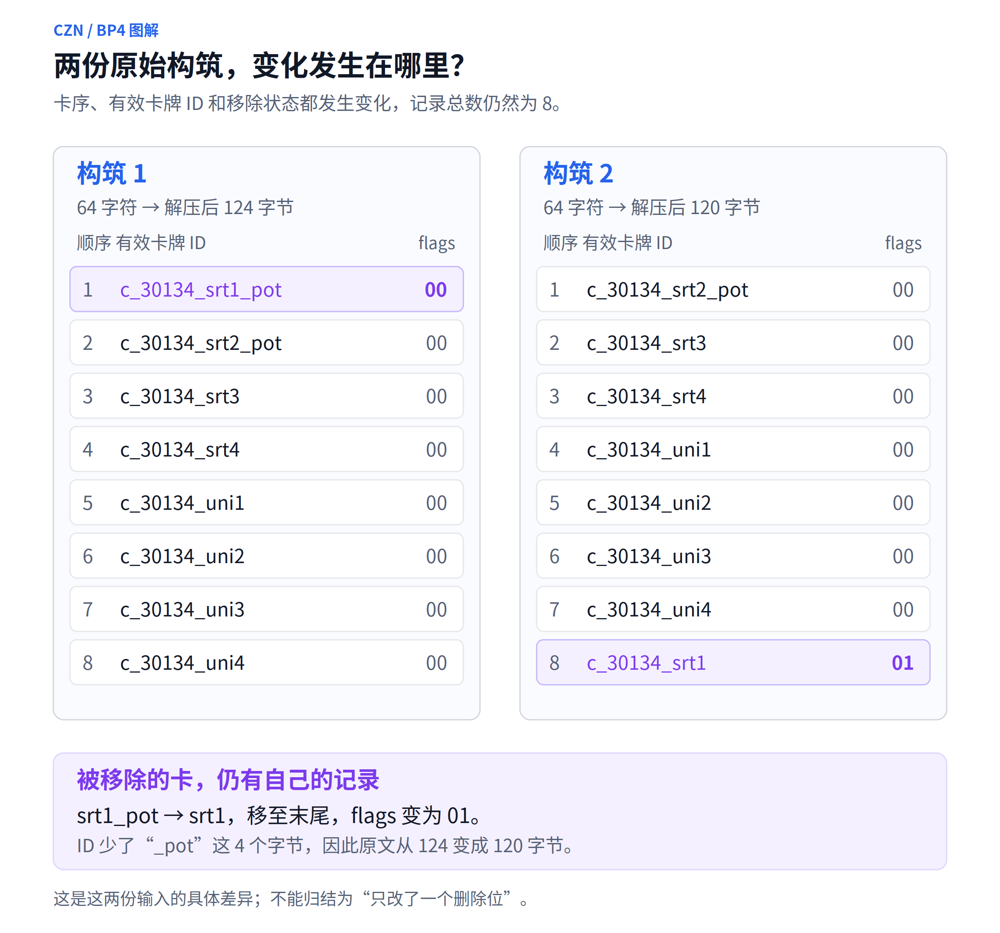
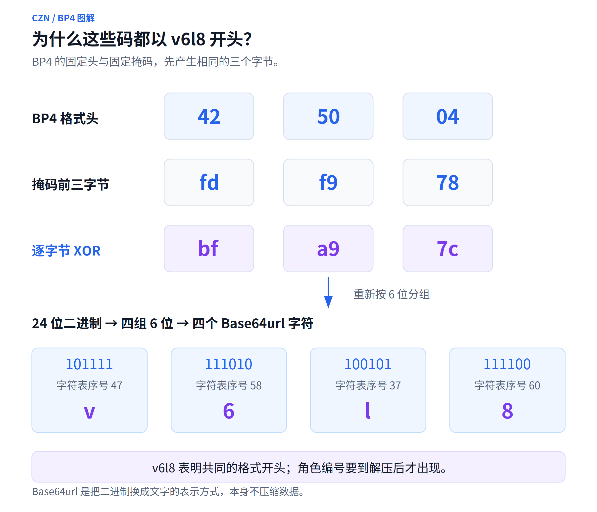
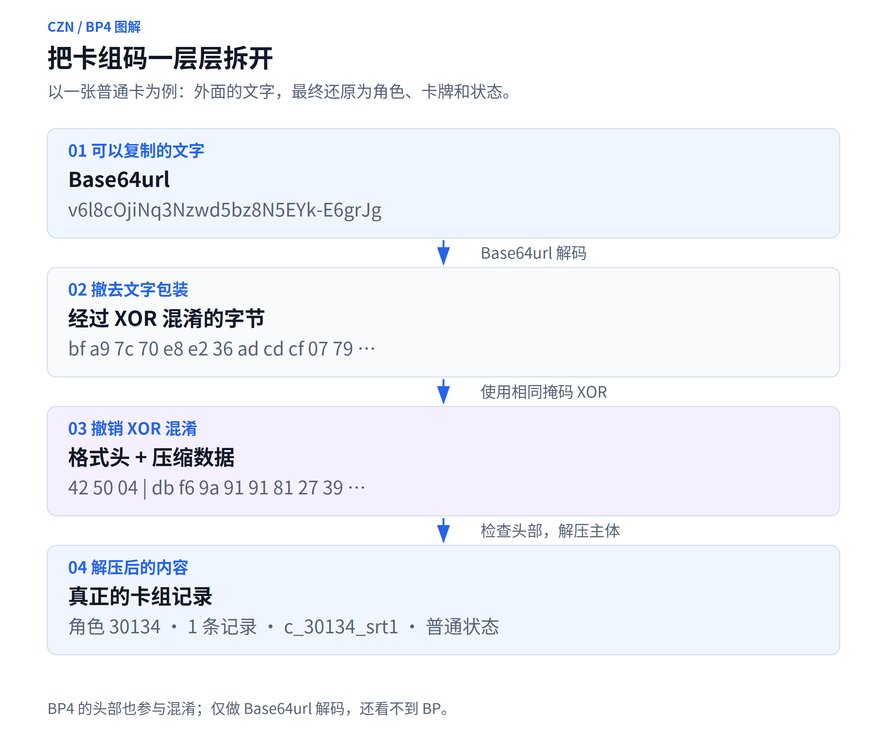
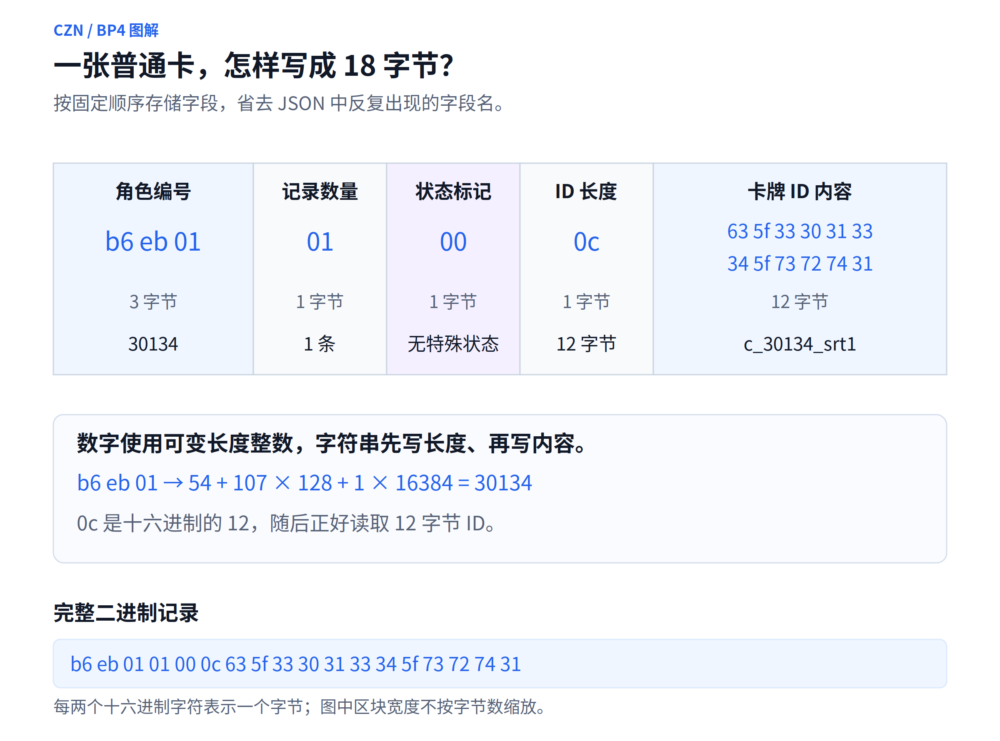
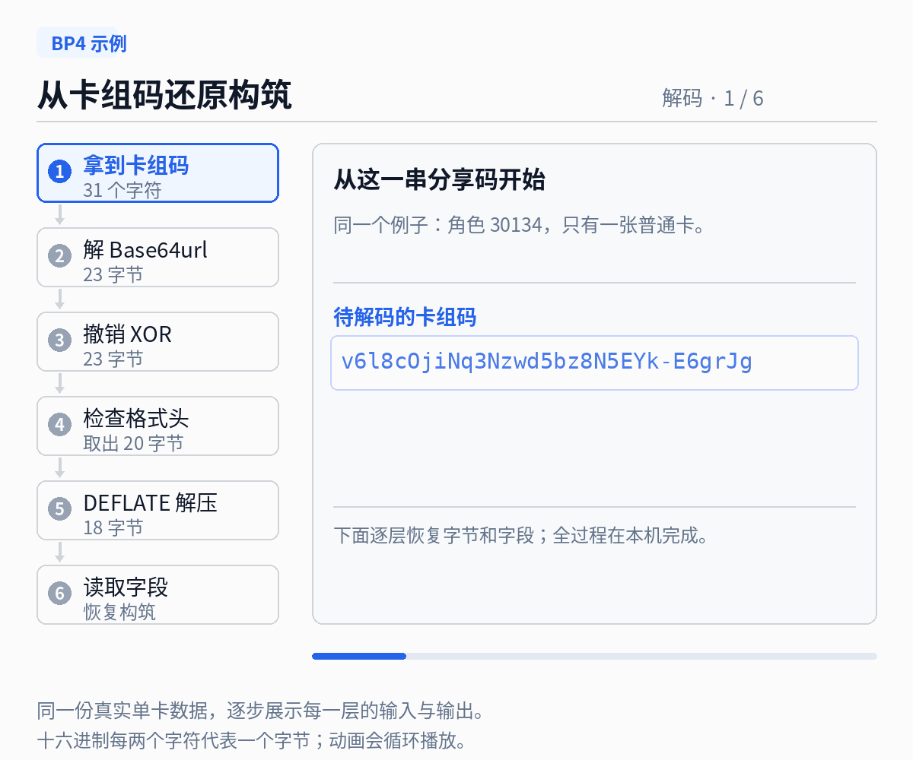
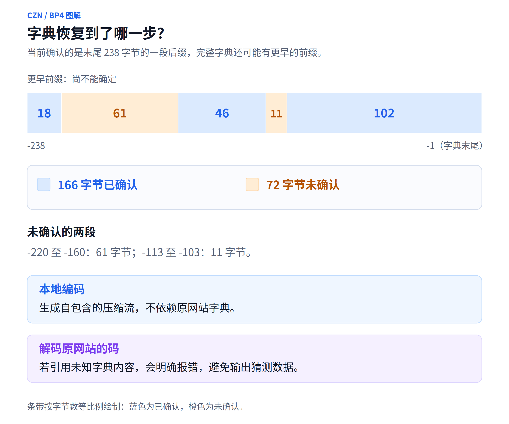

# 关于卡厄思梦境的卡组码编解码原理，根据大量的卡组码示例反推其编解码算法

分享一套《卡厄思梦境》构筑时，我们复制的是一串字母和数字。对方粘贴之后，角色、卡牌和顿悟状态就能重新出现。

这些信息是怎样塞进几十个字符里的？为什么只改了一张卡，后半截卡组码却变了一大片？如果网站停止服务，我们能否在自己的电脑上继续生成和读取这些码？

我从一批“输入构筑已知、导出结果已知”的样本入手，把这件事拆成可以逐步验证的问题。最终还原出的流程是：**先把构筑写成紧凑的二进制，压缩，加上格式头，做一次可逆混淆，最后转成方便复制的文字。**

> 本文研究的是 `cznmetadecks.com` 网站采样中使用的 **BP 第 4 版格式**。相关字段、参数和例子均有本地实现与样本对照；结论的范围以这个格式为准。

## 一、先从两串看起来很像的码开始

最初的两份样本，角色都是 `30134`。

第一份构筑带着 8 张卡，前两张使用 `_pot` 变体，导出的码是：

```text
v6l8cOjiNr8NyAd5bz8N5Gb4BacatRLcP_gTJk6Sy-IpI4UudHIDQRTERzqzgUXu
```

第二份把第一张卡标记为移除，导出结果变成：

```text
v6l8cOjiNr8NyAd5bz8N5Gb4OqcatZtbvCimK8hSEmQXL6ecqhDgm1Wc7cJpLBLu
```

两串码都是 64 个字符，有一段相同的开头，后面则出现了大量差异。这里很容易产生一个直觉：某个字符对应一张卡，找到变化的位置，就能找到“移除开关”。

实际输入比这个直觉复杂。第二份构筑里，被移除的卡还被放到了列表末尾，并从 `_pot` 变体回到了基础 ID。也就是说，卡序、卡牌 ID 和移除状态同时变了。



*图1：移除后的卡仍有一条记录。比较样本时，需要先分清究竟改变了哪些输入。*

为了继续分析，需要更干净的实验：固定角色和其他卡牌，每次只改一项，例如只换顺序、只切换复制、只换变体。再补上多角色、数字边界、不同长度 ID 和长文本样本，观察哪些变化能够稳定重现。

这些实验各自回答不同的问题：单字段样本用于确认数据含义；数字和长度样本用于确认写法；长文本样本则帮助确认覆盖整串数据的变换规则。

## 二、第一层：把能复制的文字，变回计算机字节

观察字符范围，可以得到一个值得检验的方向：样本使用字母、数字、`-` 和 `_`，符合 **Base64url** 的字符表。

Base64url 的工作，可以理解为给二进制换一套“可打印的字母表”。它把每 3 个字节划分成四组，每组 6 个二进制位，再各自对应一个字符。

拿原始样本开头的 `v6l8` 来说，转换回去得到：

```text
v6l8 → bf a9 7c
```

本文用十六进制展示字节：每两个字符是一字节，例如 `bf` 是一个字节，`0c` 表示十进制的 12。

对整份样本执行 Base64url 解码，64 个字符就还原成了 48 字节。此时仍然看不到角色编号和卡牌 ID，说明外面的文字层下面，还有其他处理。

这里已经可以区分三个动作：Base64url 负责让数据方便复制；压缩负责减少重复内容；接下来要遇到的混淆，则负责按固定规则变换字节。它们是独立的步骤。

## 三、固定前缀的秘密：为什么总能看到 `v6l8`

进一步对照样本后，可以还原出一串用于逐字节 XOR 的掩码。

XOR，中文常叫“异或”。它有一个很好用的性质：一份数据用同一个掩码处理两次，就回到原来的值。因此，同一套运算既可以用于混淆，也可以用于撤销混淆。

当前格式的前三个字节，在撤销混淆后是：

```text
42 50 04
```

`42 50` 对应 ASCII 字符 `BP`；`04` 表示格式版本 4。它相当于文件开头写着“请按 BP 第 4 版来读”。

掩码开头则固定为 `fd f9 78`，所以前三字节的处理结果固定为：

```text
42 50 04
   XOR
fd f9 78
   ↓
bf a9 7c
   ↓ Base64url
  v6l8
```



*图2：相同的格式头，遇上相同的掩码，产生相同的外观前缀。*

只有这三个字节，当然不足以确定后面成百上千字节的规则。为继续验证，我使用了内容可控、重复片段较少的长 ID 和多卡样本，把已知输入与输出对照。

这里用到了 XOR 的另一个性质：当某段原始压缩字节能够确定，并与导出字节正确对齐时，把两者 XOR，就能算出这段候选掩码。再拿更多、更长的样本检验，才能判断它是否符合统一的生成规律。仅仅知道压缩前的卡组原文还不够，压缩器的匹配选择也要分析，不能拿任意压缩结果直接套用。

最终与样本吻合的是 **xorshift32**：一个用 32 位状态不断生成后续数字的算法。初始状态为 `0x870FCD0A`，每轮依次执行左移 13、右移 17、左移 5，并进行 XOR；更新后的数字按小端顺序输出 4 字节，作为下一段掩码。

想复现这个生成器，核心只有三行：

```python
state ^= (state << 13) & 0xFFFFFFFF
state ^= state >> 17
state ^= (state << 5) & 0xFFFFFFFF
```

保存的长样本中，连续 **1645 个压缩主体掩码字节**都与这个生成器吻合。程序因此能够按公式生成所需掩码，无需保存一张“样本有多长，密钥就有多长”的表。

每份码都从相同初始状态开始，格式头也参与 XOR。版本判断要等撤销混淆之后进行。

## 四、接着打开压缩层，卡组清单才真正出现

去掉恢复出的 3 字节格式头之后，剩余部分采用 **raw DEFLATE** 压缩。DEFLATE 也出现在常见压缩工具中；这里的 raw 表示直接使用压缩数据，不再包一层 zlib 容器头尾。

为什么卡组适合压缩？看看这些 ID：

```text
c_30134_srt1
c_30134_srt2
c_30134_srt3
```

`c_30134_srt` 被反复写了三遍。压缩程序可以用“复制前面某个位置的一段内容”来表示重复片段，减少存储量。

原网站还使用了一份**预置字典**。可以把它理解为双方事先准备好的常用片段：正式卡组还没开始写，一些常见内容就已经放进了压缩历史里。这样，第一张卡也能引用这些片段。

分析到这里，整份卡组码的层次就清楚了：



*图3：解码逐层向内，编码逐层向外。格式头是在压缩之后加入的。*

最初那两份 64 字符原码，在 Base64url 解码和撤销 XOR 后，各有 3 字节头部、45 字节压缩数据。解压后，第一份是 124 字节，第二份是 120 字节。

接下来就可以逐字段解释这份二进制清单了。

## 五、清单怎么写：先约定位置，再省掉字段名

为了看清结构，先把构筑缩小到一张卡：角色 `30134`，带一张 `c_30134_srt1`，没有移除、复制或顿悟。

用 JSON 表达，它是这样：

```json
{
  "charId": "30134",
  "cards": [
    {
      "cardId": "c_30134_srt1",
      "removed": false,
      "duplicate": false
    }
  ]
}
```

二进制里不用反复保存 `charId`、`cards`、`cardId` 这些字段名。只要约定“先写角色编号，再写卡牌数量，然后逐张写卡”，读取程序就能按顺序理解内容。

这份构筑写出来只有 18 字节：

```text
b6 eb 01 | 01 | 00 | 0c | 63 5f 33 30 31 33 34 5f 73 72 74 31
```



*图4：同一段数据按约定拆开，就能读出角色、数量、状态和卡牌 ID。图中分区用于解释字段，不按字节数等比例绘制。*

其中，`b6 eb 01` 表示数字 `30134`，使用的是 **unsigned LEB128**。这种整数写法让小数字少占字节，大数字按需要增加字节。每个字节拿出 7 位保存数字，最高位告诉读取者后面是否还有内容。

`01` 表示只有一条卡牌记录，`00` 是这张卡的状态标记，`0c` 表示后面的 ID 占 12 字节，接下来就是 `c_30134_srt1` 的 UTF-8 内容。

状态标记也采用紧凑写法，一个字节里用不同位置表示不同状态：

| 标记值 | 表示什么 |
| --- | --- |
| `0x01` | 卡牌已移除 |
| `0x02` | 后面还有顿悟类别和资源 ID |
| `0x04` | 后面还有 modifier 列表，已确认用于复制 |
| `0x40` | 后面还有神性顿悟资源 ID |

这些标记可以组合。复制卡还会在后面写入一项名为 `TALENT_REPLICATION` 的 modifier，所以复制会同时改变状态字节和记录长度。

不同变体也有不同写法：`_pot`、`_lbk` 直接进入有效卡牌 ID；`_rspN` 则保留基础卡 ID，再加上顿悟类别和资源 ID。原请求把一些信息分开填写，最终二进制可能只保留合并后的形式。

现在也能解释原始两例为什么差了 4 字节：它们都保留了 8 条记录，但那张移除卡的 ID 从 `c_30134_srt1_pot` 变成 `c_30134_srt1`，正好少了 `_pot` 的 4 字节。

卡牌顺序、ID 和状态都影响压缩输入。压缩会重新选择匹配，后面的许多字节随之变化，最终字符串上的变化范围就会大于一个状态开关。

## 六、动起来看：一张卡怎样变成31个字符

到这里，我们可以用刚才的单卡构筑，完整走一遍本地编码。下面的动画展示的是实际计算结果：


*动画1：按二进制记录、压缩、加头、XOR、Base64url 的顺序，逐步得到卡组码。可转载的静态流程图见[这里](assets/05-codec-pipeline.png)。*

每一步的数据长度是：

| 阶段 | 得到什么 |
| --- | --- |
| 按约定写字段 | 18 字节卡组记录 |
| raw DEFLATE 压缩 | 20 字节 |
| 加上 `42 50 04` | 23 字节 |
| XOR 混淆 | 仍为 23 字节 |
| Base64url，去掉补位等号 | 31 个字符 |

你可能注意到了：18 字节压缩后居然变成了 20 字节。小数据也要支付压缩格式本身的开销，因此不保证每次都缩短。完整卡组有更多重复片段，压缩通常更有效。

这个单卡例子的压缩结果为：

```text
db f6 9a 91 91 81 27 39 de d8 c0 d0 d8 24 be b8 a8 c4 10 00
```

加头、XOR，再转成 Base64url 后，得到：

```text
v6l8cOjiNq3Nzwd5bz8N5EYk-E6grJg
```

这就是一份实际可由本地解码器还原的 BP4 卡组码。示例的压缩字节来自当前 Python/zlib 环境，其他兼容压缩器可以选择另一种有效表示。

## 七、解码怎么做？沿着同一条路反向打开

读取这份码时，先把 Base64url 文字还原成字节，再用同样的掩码撤销 XOR。检查 `BP` 和版本号之后，取出压缩主体，解压，最后按字段顺序读取。



*动画2：解码时先恢复头部、确认格式，再打开压缩层；角色和卡牌 ID 出现在最里面。*

本例会依次读出：

```text
角色编号：30134
记录数量：1
状态标记：00
卡牌 ID 长度：12
卡牌 ID：c_30134_srt1
```

它恢复的是构筑中的标识和状态。中文名称、卡面图片、图片文件位置需要另外准备资源映射。例如读取 `c_30134_srt1` 后，再从本地资源表里找到对应图片。

## 八、怎样判断反推出来的算法真的对了

能读出一个样本，只是验证的起点。更有说服力的是让同一套规则不断接受新输入，并且能够双向工作。

这次研究保存了 61 个受控构筑、25 个成功字段样本、73 个跨角色单卡回归案例，以及数字边界、长数据和异常输入样本。它们分别用于检查不同环节，不能简单加在一起当成对全部游戏机制的覆盖。

验证主要做了三件事。首先，把网站导出的码解开，检查得到的二进制，是否与本地按字段写出的二进制逐字节一致。其次，使用本地编码器生成新码，再解码，检查格式保存的信息是否完整保留。最后，把本地新生成的码交给网站导入，验证双方确实能读懂相同格式。

保存的 8 个本地新码导入案例全部成功，结果与预期构筑一致。日常 SDK 和桌面程序执行的是本地算法；网站用于研究阶段的采样和交叉验证。

这里还有一个容易误判的地方：**同一套构筑，可以有多串有效卡组码。**

DEFLATE 对重复内容有不同的匹配选择。本地编码器生成自包含的压缩流，不引用原网站的预置字典，因此有时会比原网站输出更长。

例如，第一份原始构筑的网站码长 64 字符；当前本地编码得到：

```text
v6l8cOjiNr8NyAd5bz8N5EYk-E6gjCZ0kaTS5Q96EeRqw-lt27AxOKUXa4LIfnnSEMoy6AI
```

它长 71 字符，但两份码解压后得到的是完全相同的 124 字节构筑记录。判断兼容性，需要比较恢复出的内容和实际导入结果。

## 九、已经知道了什么，还有哪些空白

目前已经明确了 BP4 的层次、格式头、掩码生成器、字段布局以及这些样本中出现的状态和变体。对应的本地 SDK 已经实现，压缩使用 Python 标准库 zlib，其余字段转换和混淆按还原出的规则处理，运行时无需网络接口。

预置字典还有部分内容尚未确认。现在恢复的是原字典末尾的一个 238 字节后缀，其中 166 字节已观察确认，72 字节仍未知；完整字典可能还有更早的前缀。



*图5：已知和未知的范围只描述当前观察到的238字节后缀，不代表完整字典总长度。*

对于未知位置，本地解码器采用两种不同填充值分别解压。如果两次输出不同，就说明结果依赖未确认内容，程序会明确报错。超出当前字典范围的引用也可能无法解压。

本地编码使用自包含压缩流，生成新码不需要猜这些未知字节；读取原网站码时，则仍要面对字典恢复范围的限制。未来的新版本、新标记和新 modifier，也需要新样本继续验证。

从这次分析可以看到，一串看起来很难理解的卡组码，能够被分解为一组明确的问题：文字怎样表示字节，固定前缀怎样产生，重复片段怎样压缩，字段又怎样按顺序排列。每一层都有可验证的输入和输出，反推工作就在这些对应关系中逐步推进。

### 想自己试一下

项目中的 SDK 名为 `czn-deckcode`。安装本地 wheel 或项目源码后，可以这样调用：

```python
from czn_deckcode import encode, decode

deck = {
    "charId": "30134",
    "cards": [{"cardId": "c_30134_srt1"}],
}

code = encode(deck)
print(code)
print(decode(code).to_dict())
```

想查看逐步字节、精确字段和证据位置，可以继续阅读[《卡组码结构与本地编解码实现报告》](../卡组码结构与编解码报告.md)、[格式说明](../format.md)、[字典恢复记录](../dictionary.md)和[采样说明](../../research/README.md)。SDK 源码位于项目的 `src/czn_deckcode/`。

*本文配图和 GIF 均根据本文样例制作。研究对象是已采样的 BP4 格式；已验证结果与尚未知的范围在文中分别说明。*
