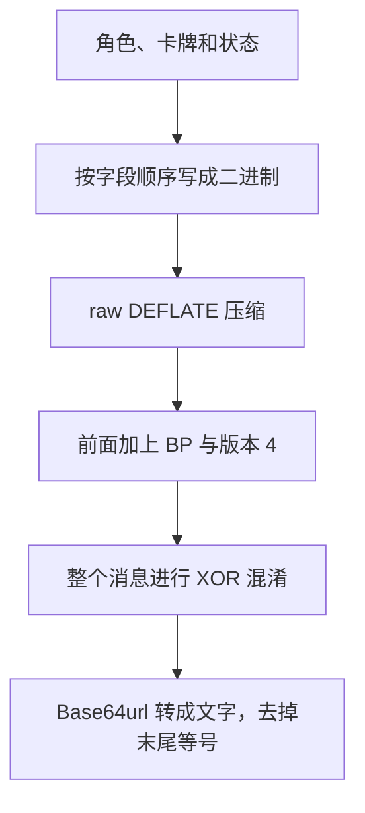

# 卡组码结构与本地编解码实现报告

日期：2026 年 10 月 26 日

适用范围：从 `cznmetadecks.com` 采集并验证的 BP 第 4 版卡组码，以及本项目 `czn-deckcode 0.1.0a2` 的实现。

本文先说明卡组码里装了什么，再展示如何编码、如何解码，以及这些规则是怎样验证的。十六进制数据中的每两个字符表示一个字节，例如 `0c` 表示十进制的 12。

## 1. 卡组码整体是什么结构

一份卡组码保存的是一名角色的构筑：角色编号、按顺序排列的卡牌，以及移除、复制、变体、顿悟等状态。最终那串文字是这些数据经过打包、压缩、混淆后形成的。

先看解压后的卡组数据骨架：

```text
卡组数据 = 角色 ID + 卡牌数量 + 卡牌记录 × 数量

一张卡的记录 =
    状态字节 flags
    + 有效卡牌 ID
    + [闪光类别 + 闪光资源 ID]
    + [神性资源 ID]
    + [复制用的 modifier 列表]
```

方括号表示可选字段：对应状态存在时才会写入。最终的卡组码字符串是在这份数据骨架外，再经过压缩、加格式头、XOR 混淆和 Base64url 转换得到的。

从内部数据到最终文字，编码顺序如下：



从外向内看，则有下面几层：

| 层次 | 实际内容 | 作用 |
| --- | --- | --- |
| 最外层 | Base64url 字符串 | 使用字母、数字、`-`、`_` 表达二进制，方便复制和分享 |
| 解开文字后 | 经过 XOR 混淆的字节 | 用固定规则变换数据，解码时可以还原 |
| 撤销混淆后 | `42 50 04` 加上压缩数据 | `42 50` 是 ASCII 的 `BP`，`04` 是格式版本 |
| 解压后 | 角色、卡牌数量、卡牌记录 | 真正的构筑数据 |

**格式头在混淆之前加入，也参与混淆。**所以只做 Base64url 解码，还不能直接看到 `BP`。

BP4 的固定头经过混淆后为 `bf a9 7c`，转成 Base64url 恰好是 `v6l8`。这解释了当前样本为什么都有相同前缀。它是格式特征；角色编号要到解压后才能读到。

### 1.1 网站响应与卡组码的边界

你提供的接口响应形如：

```text
0:{"a":"$@1", ...}
1:[{"ok":true,"code":"v6l8..."}, ...]
```

真正送入解码器的是 `code` 字段中的字符串。`0:`、`1:`、`ok`、`cannotExport` 等属于网站的响应包装，不进入卡组码。请求里的多位置数组和 `null` 也是接口包装；本 SDK 的一次 `encode()` 处理一名角色的一份构筑。

## 2. 解压后的卡组数据怎样排列

数据从前往后依次是：

```text
角色编号
卡牌记录数量
第 1 条卡牌记录
第 2 条卡牌记录
……
```

这里不重复存储 JSON 中的 `charId`、`cards`、`cardId` 等字段名。程序按照固定顺序读取，就知道每一段代表什么。卡牌顺序会保留，也会影响最终编码结果。

### 2.1 整数与字符串

整数使用 unsigned LEB128，可以理解为“数字小就少占字节，数字大就多占字节”。每个字节低 7 位存数字，最高位说明是否还有后续字节。

例如，角色编号 `30134` 保存为：

```text
b6 eb 01
```

还原计算为：

```text
(b6 去掉最高位) + (eb 去掉最高位) × 128 + 01 × 128²
= 54 + 107 × 128 + 1 × 16384
= 30134
```

字符串采用“UTF-8 字节数 + UTF-8 内容”的结构。例如：

```text
0c | 63 5f 33 30 31 33 34 5f 73 72 74 31
长度 12 | c_30134_srt1
```

长度统计的是字节数。本例的 ID 全是 ASCII 字符，一个字符正好一个字节。

### 2.2 一条卡牌记录

一条记录按以下顺序排列：

```text
状态标记 flags：1 字节
有效卡牌 ID：长度 + UTF-8 内容
[顿悟类别 + 顿悟资源 ID]          有相应标记时存在
[神性顿悟资源 ID]                有相应标记时存在
[modifier 数量 + modifier 列表]   有相应标记时存在
```

已确认的状态标记如下：

| 标记值 | 含义 | 对后续数据的影响 |
| --- | --- | --- |
| `0x01` | 这张卡已移除 | 设置移除状态，记录本身仍然存在 |
| `0x02` | 存在顿悟字段 | 继续读取一个类别字节和一个资源 ID |
| `0x04` | 存在 modifier 列表 | 继续读取数量和 modifier 字符串；已确认用于复制 |
| `0x40` | 存在神性顿悟字段 | 继续读取神性顿悟资源 ID |

多个状态可以组合。例如“移除 + 复制”对应 `0x01 | 0x04 = 0x05`。未使用任何已知状态时，flags 为 `00`。

复制状态还会在记录末尾写入：

```text
01 | 12 | TALENT_REPLICATION 的 UTF-8 字节
数量 1 | 长度 18 | 复制 modifier 的名称
```

因此，复制不仅改变 flags，还会增加一段数据。当前 SDK 只接受已经确认的这个 modifier；遇到未知列表结构会报错。

### 2.3 变体、顿悟怎样保存

| 编辑器中的信息 | 卡组码中的保存方式 |
| --- | --- |
| `variantCardId = c_30134_srt1_pot` | 有效卡牌 ID 直接保存为 `c_30134_srt1_pot` |
| `_lbk` 变体 | 同样直接写进有效卡牌 ID |
| `variantCardId = c_30134_srt1_rsp2` | 保留基础卡 ID，添加顿悟类别 `1`，资源 ID 为 `rsp2_c_30134_srt1` |
| 公共顿悟，例如 `epiphanyId = c00001` | 添加顿悟类别 `3`，资源 ID 为 `c00001` |
| `divineId` | 在顿悟字段之后保存完整神性资源 ID |
| `god` | 不单独保存；解码时可从已识别的神性资源 ID 推导 |

在已还原的规则里，`_rspN` 变体优先于普通 `epiphanyId`；神性字段需要同时有顿悟字段。

这也解释了为什么解码后的 JSON 不一定和原请求逐字段相同。例如，输入可能把基础 ID 和 `_pot` 变体分开填写；编码只保留有效 ID，解码后就放在 `cardId` 中，`variantCardId` 留空。验证时应比较格式真正保存的构筑信息。

卡组码保存资源 ID。图片、中文名称、卡面描述和本地图片路径需要另行准备资源映射，不能直接从码中还原出来。

### 2.4 多种状态怎样组合，以及“编解码一致”是什么意思

可以把 `flags` 看成这一条卡牌记录的目录：它告诉解码器这张卡有哪些状态，以及后面还要读取哪些字段。状态不是互斥选项，可以按位相加。例如，一张卡同时被移除、带独特闪光、带神性、并且是复制牌时：

```text
0x01 移除
+ 0x02 有闪光字段
+ 0x04 有复制 modifier
+ 0x40 有神性字段
= 0x47
```

对应的一条记录按固定次序写成：

```text
47
0c | c_30134_srt1
01 | 11 | rsp2_c_30134_srt1
14 | add_r_spark_vitor_01
01 | 12 | TALENT_REPLICATION
```

其中 `47` 是组合后的状态字节；`0c`、`11`、`14` 分别是后续 UTF-8 字符串的字节长度；`01` 是独特闪光类别；最后的 `01` 表示 modifier 数量为 1。这里的神性 ID 会保留下来，`god` 名称则可由它推导。这个组合也有对应的序列化回归测试。

普通闪光与独特闪光共用 `0x02`，靠类别字节区分：普通闪光用类别 `3` 并保存普通闪光资源 ID；独特闪光用类别 `1` 并保存重新排列后的 `_rspN` 资源 ID。一张卡记录只有一个闪光资源字段；如果输入同时提供 `_rspN` 和普通 `epiphanyId`，编码时 `_rspN` 优先。

“赛季卡牌”不是 BP4 记录中的单独状态位。卡牌若属于某个赛季，码里仍保存它的卡牌 ID，由外部卡牌目录根据 ID 映射名称、图片和所属类别。`_pot`、`_lbk` 这类变体也没有专门状态位，而是把后缀并入有效卡牌 ID。

这里说编解码“**一致**”，指的是牌组数据的语义能够往返还原，而不是 JSON 字段或最终字符串必须逐字相同：

- 卡牌数量和卡牌顺序会保留；移除状态也保留在该卡的记录里。
- `_pot`／`_lbk` 变体会折叠进解码后的 `cardId`，而不是恢复成原先分开的 `variantCardId` 字段。
- `god` 可以从 `divineId` 推导，不需要重复保存。
- 不同压缩器可以为相同的二进制牌组生成不同的有效 DEFLATE 表示，所以卡组码字符串可能不同，但解码后的牌组内容相同。

因此，验证往返时应比较卡牌顺序和格式实际表达的状态，不应只比较编码前后的 JSON 文本或卡组码字符串。Base64url 和 XOR 也不是完整性校验；BP4 没有密码学签名或校验和，不能用来证明内容未被改动。

## 3. 完整编码示例：一张卡怎样变成卡组码

以下是本地编码器的实际计算结果，足以逐步复查。压缩结果由当前 Python/zlib 环境产生，其他兼容压缩器可能选择另一种有效表示。

### 3.1 输入

```json
{
  "charId": "30134",
  "cards": [
    {
      "cardId": "c_30134_srt1",
      "removed": false,
      "duplicate": false
    }
  ]
}
```

### 3.2 写成二进制：18 字节

```text
b6 eb 01 | 01 | 00 | 0c | 63 5f 33 30 31 33 34 5f 73 72 74 31
角色30134 | 1张 | 状态 | 长度 | c_30134_srt1
```

完整内容：

```text
b6 eb 01 01 00 0c 63 5f 33 30 31 33 34 5f 73 72 74 31
```

### 3.3 raw DEFLATE 压缩：20 字节

本地编码调用 Python 标准库 zlib：

```python
compressor = zlib.compressobj(level=9, wbits=-15)
compressed = compressor.compress(payload) + compressor.flush()
```

`wbits=-15` 表示输出原始 DEFLATE 数据，不加 zlib 容器头尾。该示例的输出是：

```text
db f6 9a 91 91 81 27 39 de d8 c0 d0 d8 24 be b8 a8 c4 10 00
```

这个例子太短，压缩开销使长度从 18 增加到 20 字节，属于正常情况。重复内容更多的完整构筑通常更容易被压缩。

### 3.4 加上格式头：23 字节

在压缩结果前加入 `42 50 04`：

```text
42 50 04 db f6 9a 91 91 81 27 39 de d8 c0 d0 d8 24 be b8 a8 c4 10 00
```

### 3.5 整体 XOR 混淆：长度仍为 23 字节

掩码通过固定初始状态 `0x870FCD0A` 和 xorshift32 生成。每轮先更新状态：

```python
state ^= (state << 13) & 0xFFFFFFFF
state ^= state >> 17
state ^= (state << 5) & 0xFFFFFFFF
```

再把状态按小端顺序拆成 4 字节，与接下来的最多 4 个消息字节逐个 XOR。每份新卡组码都从同一个初始状态开始。

本例需要的掩码为：

```text
fd f9 78 ab 1e 78 a7 3c 4c e8 3e a7 b7 ff dd 3c 62 9a 40 e6 64 bc 98
```

例如头部的变换：

```text
42 XOR fd = bf
50 XOR f9 = a9
04 XOR 78 = 7c
```

完整结果为：

```text
bf a9 7c 70 e8 e2 36 ad cd cf 07 79 6f 3f 0d e4 46 24 f8 4e a0 ac 98
```

XOR 的特点是 `A XOR B XOR B = A`，所以解码使用同一串掩码就能恢复数据。该步骤属于格式混淆，没有个人密码或联网获取密钥的过程。

### 3.6 Base64url 转文字：31 个字符

Base64 每次把 3 字节划分为四组 6 位，再查字符表。例如前三字节：

```text
bf a9 7c
→ 101111 111010 100101 111100
→ 47     58     37     60
→ v      6      l      8
```

Base64url 使用 `-`、`_` 替代普通 Base64 中的 `+`、`/`。本例转换并带补位等号时为：

```text
v6l8cOjiNq3Nzwd5bz8N5EYk-E6grJg=
```

去掉末尾 `=` 后，最终卡组码是：

```text
v6l8cOjiNq3Nzwd5bz8N5EYk-E6grJg
```

整个过程的长度变化为：

| 阶段 | 长度 |
| --- | --- |
| 二进制卡组记录 | 18 字节 |
| 压缩结果 | 20 字节 |
| 加格式头 | 23 字节 |
| XOR 后 | 23 字节 |
| Base64url 去掉补位等号 | 31 个字符 |

## 4. 解码怎样执行

以刚才生成的 31 字符卡组码为例：

1. 检查字符和长度，按需要补回末尾 `=`，Base64url 解码得到 23 字节。
2. 从固定初始状态重新生成掩码，对全部 23 字节 XOR，恢复 `42 50 04` 和压缩数据。
3. 检查前两字节是否为 `BP`，第三字节是否为支持的版本 `04`。
4. 取出头部之后的 20 字节，按 raw DEFLATE 解压，恢复 18 字节卡组记录。
5. 读取可变长度整数，得到角色 `30134`、记录数量 `1`。
6. 读取 flags `00`，再读长度 `0c` 和 12 字节 ID，得到 `c_30134_srt1`。
7. 确认记录读完且没有多余数据，构造 `Deck` 和 `Card` 返回。

结果为第 3.1 节的 JSON。网站使用预置字典的码，在第 4 步还要使用本地保存的字典片段，详见第 6 节。

SDK 同时检查非法 Base64url、错误头部、不支持的版本、截断的压缩流、未知标记、异常整数和未读完的数据。当前实现限制输入码最多 2 MiB 字符、解压数据最多 1 MiB、单个标识符最多 255 个 UTF-8 字节。这些是本项目的处理边界，不应全部视为游戏规则。

## 5. 你的两份原始卡组码，实际包含什么

构筑 1 原码：

```text
v6l8cOjiNr8NyAd5bz8N5Gb4BacatRLcP_gTJk6Sy-IpI4UudHIDQRTERzqzgUXu
```

构筑 2 原码：

```text
v6l8cOjiNr8NyAd5bz8N5Gb4OqcatZtbvCimK8hSEmQXL6ecqhDgm1Wc7cJpLBLu
```

本地逐层拆解的结果：

| 项目 | 构筑 1 | 构筑 2 |
| --- | --- | --- |
| 最外层文字 | 64 字符 | 64 字符 |
| Base64url 解码后 | 48 字节 | 48 字节 |
| 撤销 XOR 后的头部 | `42 50 04` | `42 50 04` |
| 压缩主体 | 45 字节 | 45 字节 |
| 解压后卡组记录 | 124 字节 | 120 字节 |
| 角色 | `30134` | `30134` |
| 卡牌记录数 | 8 | 8 |

记录的具体内容和顺序如下。表中的状态是 flags 字节：

| 序号 | 构筑 1 有效卡牌 ID / 状态 | 构筑 2 有效卡牌 ID / 状态 |
| --- | --- | --- |
| 1 | `c_30134_srt1_pot` / `00` | `c_30134_srt2_pot` / `00` |
| 2 | `c_30134_srt2_pot` / `00` | `c_30134_srt3` / `00` |
| 3 | `c_30134_srt3` / `00` | `c_30134_srt4` / `00` |
| 4 | `c_30134_srt4` / `00` | `c_30134_uni1` / `00` |
| 5 | `c_30134_uni1` / `00` | `c_30134_uni2` / `00` |
| 6 | `c_30134_uni2` / `00` | `c_30134_uni3` / `00` |
| 7 | `c_30134_uni3` / `00` | `c_30134_uni4` / `00` |
| 8 | `c_30134_uni4` / `00` | `c_30134_srt1` / `01`，已移除 |

构筑 2 仍然保存 8 条记录，移除卡被放到了最后，并用 `01` 标记。在这两份输入中，该卡还从 `_pot` 版本改回基础版本，ID 从 16 字节缩短为 12 字节，解释了解压结果少掉的 4 字节。

所以这两个案例同时改变了记录顺序、有效卡牌 ID 和移除状态。不能把最终字符串的变化全部归到某个“删除开关”。压缩还会根据前面的内容改变后续匹配，字符串上连续变化的一段不对应固定的一张卡。

## 6. 原网站与本地编码器的压缩方式

### 6.1 原网站使用预置字典

DEFLATE 能用较短的描述表达重复内容，例如“复制前面某个位置的一段字节”。预置字典相当于在正式数据之前，预先放好一批经常出现的 ID 片段，让第一条卡牌记录也能使用这种简写。

已观察确认的片段包括 `_srt1`、`_uni1`、`_rsp1`、`_pot`、`_lbk` 以及复制 modifier 的相关内容。解码时把它们准备在本地，就可以还原这些引用。

raw DEFLATE 不附带 zlib 容器里的字典标识和校验字段；本格式按约定使用预置字典。缺少字典时，直接用普通解压函数可能出现“引用距离超出已有数据”的错误。

### 6.2 本地编码生成自包含的压缩流

本 SDK 编码时不引用原网站的预置字典，而是生成自包含的 raw DEFLATE 流。它仍按相同规则写入 BP4 头部、进行 XOR 和 Base64url 转换。网站解码器已经在保存的 8 个新码案例中成功导入这种表示。

同一份构筑因此可以对应不同的有效字符串。例如构筑 1：

```text
原网站码（64 字符）：
v6l8cOjiNr8NyAd5bz8N5Gb4BacatRLcP_gTJk6Sy-IpI4UudHIDQRTERzqzgUXu

当前本地编码结果（71 字符）：
v6l8cOjiNr8NyAd5bz8N5EYk-E6gjCZ0kaTS5Q96EeRqw-lt27AxOKUXa4LIfnnSEMoy6AI
```

这两份码解压后得到完全相同的 124 字节卡组记录。更换兼容的压缩实现，也可能产生其他等价结果。

### 6.3 当前字典恢复范围

当前实现使用从游戏客户端编解码模块提取的完整 245 字节字典，字节串的 SHA256 为 `7cad876fad355e347395665d045572f20867e8830a6d25dd6837a13b1bfc7d9c`。此前从样本反推时只确认了其中一部分；客户端模块的提取补全了此前未知的前缀和两个内部区段。字典片段、偏移和模块哈希记录在 `docs/dictionary.md` 与 `research/samples/client_dictionary.json`。

SDK 解码器使用完整字典解压游戏导出的 BP4 码，并继续检查压缩流是否截断、是否带有多余尾随数据，以及解压结果是否超过大小上限。当前有 7 条真实游戏导出码作为离线回归样本，覆盖移除卡、复制、闪光和记忆卡等状态。

本地编码仍输出不引用预置字典的自包含 raw DEFLATE 流；格式兼容不要求压缩字节与网站导出逐字节相同。当前验证范围是 BP4，不能据此推断未来版本也使用相同字典或结构。

## 7. 这些规则是怎样还原和验证的

本项目依据受控输入与网站输出进行格式分析，没有服务端源码。研究期间使用网站导出、导入来采集和交叉验证；日常运行的 SDK 和桌面程序执行的是本地算法。

| 分析工作 | 用来确认什么 | 保存的证据 |
| --- | --- | --- |
| 固定其他数据，逐次改变卡牌、顺序、移除、复制和变体 | 字段语义、顺序和状态标记 | `30134.json`、`fields.json`、`matrix.json` |
| 角色数字边界、不同 ID 长度与形式 | 可变长度整数、字符串长度和 uint32 边界 | `numeric.json` |
| 构造已知内容的长 ID，减少重复片段 | 恢复连续掩码，识别 xorshift32、初始状态和字节对齐 | `stream_short/medium/long.json` |
| 分析 DEFLATE 对预置字典的引用 | 确认字典内容及其相对位置 | `dictionary_probes.json` |
| 输入超过 32 KiB 历史窗口的已知内容 | 让初始字典退出可引用范围，观察复制 modifier 的真实内容 | `dictionary_window_flush.json` |
| 把本地新生成的码交给网站导入 | 验证本地编码能与已有解码器互通 | `local_export_verification.json` |

长样本支持连续 1645 个压缩主体掩码字节与生成器一致。实现通过公式生成任意所需长度的掩码，没有把这些样本当成固定密钥表。

当前保存的主要验证范围包括：61 个受控构筑（含最初两例）、25 个成功字段样本、73 个跨角色单卡回归案例，以及 8 个已被网站成功导入的本地新码。这些集合有不同用途，不应相加后声称覆盖所有卡牌和机制。另有数字边界、长数据和异常输入测试。

验证重点有三项：网站码解压后的字节与本地序列化结果一致；本地编码再解码后保留格式所表达的信息；本地新码可被网站导入。图片显示和卡组在游戏内是否合法属于另外的问题。

## 8. 本地 SDK 怎样实现、怎样调用

### 8.1 实现文件

| 文件 | 职责 |
| --- | --- |
| [`models.py`](../src/czn_deckcode/models.py) | `Deck`、`Card` 模型，JSON 字段转换与基本校验 |
| [`_serialization.py`](../src/czn_deckcode/_serialization.py) | 按 BP4 顺序写入、读取整数、字符串、flags 和可选字段 |
| [`_compression.py`](../src/czn_deckcode/_compression.py) | 使用标准库 zlib 压缩、本地字典解压和未知引用检查 |
| [`_obfuscation.py`](../src/czn_deckcode/_obfuscation.py) | xorshift32 掩码生成与 XOR |
| [`codec.py`](../src/czn_deckcode/codec.py) | 组合各层，提供 `encode()`、`decode()` |
| [`__init__.py`](../src/czn_deckcode/__init__.py) | SDK 对外导出 |
| [`ui.py`](../src/czn_deckcode/ui.py) | 原生桌面界面，直接调用 SDK |

格式序列化和混淆逻辑是本项目实现的；DEFLATE 和 Base64 使用 Python 标准库。运行时没有第三方 Python 依赖，也没有 HTTP、登录、账号或网络请求步骤。研究样本仅用于开发验证，SDK 运行时不读取它们。

### 8.2 可运行的调用例子

在项目目录安装后执行，或者使用 `PYTHONPATH=src python3` 从源码运行：

```python
from czn_deckcode import encode, decode

deck = {
    "charId": "30134",
    "cards": [
        {
            "cardId": "c_30134_srt1",
            "removed": False,
            "duplicate": False,
        }
    ],
}

code = encode(deck)
restored = decode(code).to_dict()
print(code)
print(restored)
assert restored == deck
```

在本文验证环境中的输出码为：

```text
v6l8cOjiNq3Nzwd5bz8N5EYk-E6grJg
```

如需查看每一步的实际字节，可运行：

```python
import base64
from czn_deckcode import Deck, encode, decode
from czn_deckcode._serialization import serialize
from czn_deckcode._compression import compress
from czn_deckcode._obfuscation import transform

deck = Deck.from_dict({
    "charId": "30134",
    "cards": [{"cardId": "c_30134_srt1"}],
})
payload = serialize(deck)
compressed = compress(payload)
message = b"BP\x04" + compressed
wire = transform(message)
code = base64.urlsafe_b64encode(wire).decode("ascii").rstrip("=")

for label, value in (
    ("二进制记录", payload),
    ("压缩结果", compressed),
    ("加头部", message),
    ("XOR 后", wire),
):
    print(label, len(value), value.hex(" "))
print("最终卡组码", code)
assert code == encode(deck)
assert decode(code) == deck
```

这段检查代码使用以下划线开头的内部模块来展示中间结果；其他项目正常集成时只需使用公开的 `encode()`、`decode()`、`Card` 和 `Deck`。

## 9. 当前结论的适用边界

已确认并实现的范围是本报告描述的 BP4 结构、字段、混淆和压缩处理。原始两码及现有有效采样均有本地验证，源码和样本可供复查。

仍然未知的内容包括部分预置字典，以及没有采样确认的新版本、新标记或新 modifier 语义。SDK 会对已识别的未知结构或未知字典引用报错，不承诺解析所有未来码。BP4 当前结构中也未发现可用于检测一切内容修改的密码学完整性校验；结构合法的改动仍可能被解释为另一份数据。

相关详细资料：

- [原有格式说明](format.md)
- [字典恢复位置与证据](dictionary.md)
- [样本说明](../research/README.md)
- [离线编解码回归测试](../tests/test_codec.py)
- [项目 README 与安装方式](../README.md)
